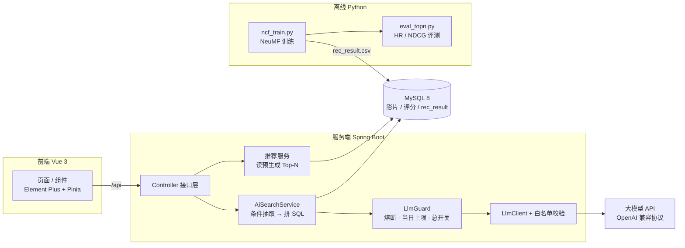
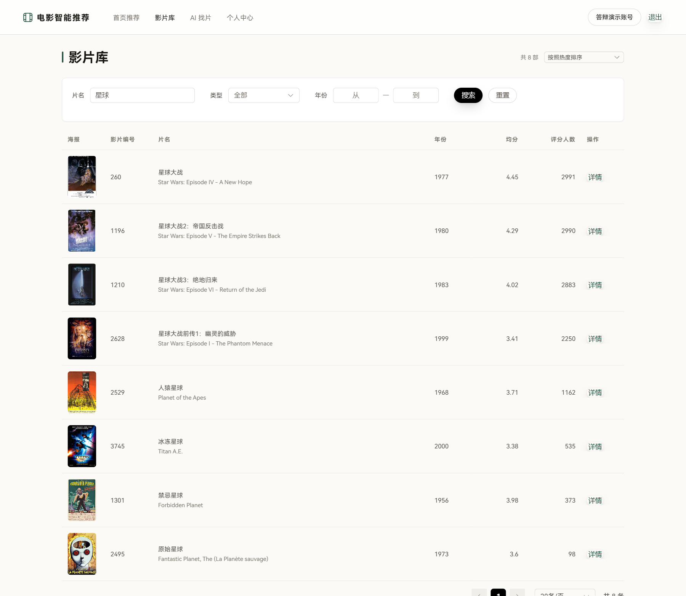
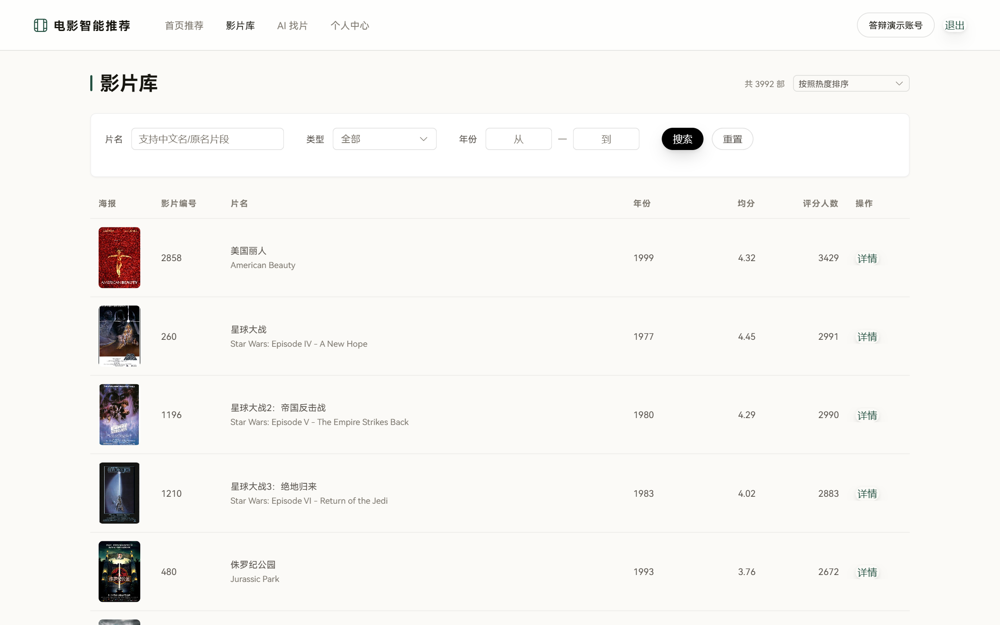
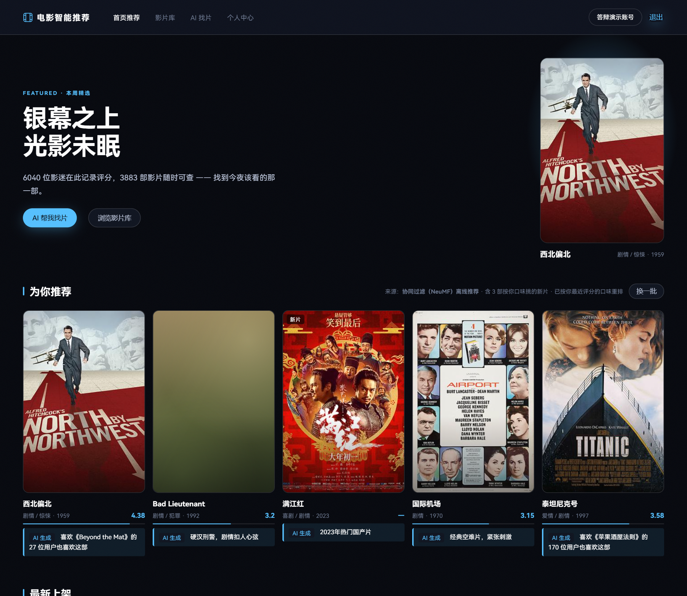

# 电影智能推荐系统

融合协同过滤与大语言模型的电影推荐系统。后端 Spring Boot + MySQL，前端 Vue 3，算法层 Python。

核心链路：**NeuMF 离线召回 → LLM 生成推荐理由 → 自然语言找片（LLM 抽条件 → 参数化 SQL）**。

## 关于本仓库

本仓库只做一件事：把**能验证的部分**摊开——算法选型是怎么定的、LLM 怎么接才不出事。

- `script/` 离线算法链完整可跑：NeuMF / SVD / KNN 的训练与评测，加上两组消融实验，结果 CSV 是原始产物
- `backend/` 只保留 LLM 接入相关的 7 个类与 4 个测试：Prompt 分层、熔断与限额、输出白名单校验
- 完整系统（Vue 3 前端、接口层、数据库脚本）未随仓库发布，因此 **Java 代码是节选，单独 clone 不能编译**；功能全貌见截图与实验结果

LLM 语义重排经离线消融实验验证**无提升**，因此线上只让大模型生成理由、不参与排序——重排代码保留在仓库中用于复现该结论。

## 跑起来

```bash
pip install -r script/requirements.txt

# 下载 ml-1m 解压到 script/ml-1m/（需含 ratings.dat 与 movies.dat）
cd script

python baseline_surprise.py --cv 3    # 评分预测：SVD / NMF / UserCF / ItemCF
python ncf_train.py --epochs 20       # Top-N：NeuMF 训练 + HR@10 / NDCG@10
python -m pytest -q                   # 6 个测试文件
```

`llm_rerank_ablation.py` 需要 `LLM_API_KEY` 环境变量（任一 OpenAI 兼容接口）。

## 架构



## 界面预览

| 首页推荐 | AI 找片 |
| :---: | :---: |
|  |  |
| NeuMF 离线结果 + 大模型生成的理由与协同依据 | 一句话 → AI 理解到的条件 → 结果列表 |


| 影片库检索 |
| :---: |
|  |
| 片名模糊匹配（中英文均可）+ 类型 / 年份区间 + 热度排序 |

<details>
<summary>更多截图（影片库总览、冷启动引导、深色主题）</summary>

| 影片库总览 | 冷启动选片 | 午夜靛蓝主题 |
| :---: | :---: | :---: |
|  |  |  |

</details>

## 功能

| 模块 | 说明 |
| --- | --- |
| 个性化推荐 | NeuMF 离线训练并预生成 Top-N，线上只读结果；冷启动按「热度 / 最新」分级兜底，永不空返回 |
| 推荐理由 | 大模型为每部推荐影片生成一句中文理由，并把协同依据（「喜欢《X》的 N 位用户也爱看」）一并喂给模型，让协同过滤的效果可见 |
| AI 找片 | 一句自然语言 → 结构化条件（类型 / 年份 / 关键词 / 相似影片）→ 后端拼装参数化 SQL |
| 影片库与评分 | 影片检索、年份与评分排序、打分与评论；豆瓣元数据回填（中文名 / 海报 / 评分） |
| 账号体系 | 注册登录、评分历史、口味偏好 |
| 界面主题 | 纸白极简 / 午夜靛蓝两套主题，切换后本地持久化，不绑定账号 |

## 技术栈

| 层 | 选型 |
| --- | --- |
| 后端 | Java 25、Spring Boot 3.5、MyBatis-Plus、MySQL 8+、Sa-Token |
| 前端 | Vue 3.5、Vite 6、Element Plus、Pinia、Axios |
| 算法 | Python 3.10+、PyTorch（NeuMF）、scikit-surprise（SVD / NMF / KNN 基线）、pandas |
| 大模型 | 任一 OpenAI 兼容接口（默认智谱 GLM-4-Flash，可换 DeepSeek），Java 侧统一封装 |

## 算法与评测口径

两套模型解决两类问题，评测口径不同，**数字不可跨表比较**：

| 任务 | 模型 | 划分方式 | 指标 |
| --- | --- | --- | --- |
| 评分预测 | SVD（主）、BaselineOnly、UserCF、ItemCF、NMF | 3 折交叉验证，五算法共用同一划分 | RMSE / MAE |
| Top-N 推荐 | NeuMF（主）、热门度、ItemKNN | 三路划分 + 留一法（每用户时间戳最后一条交互） | HR@10 / NDCG@10 |

- 评分预测最优：SVD，RMSE **0.8853** / MAE **0.6959**，落在 ml-1m 的常见区间。
- Top-N 最优：NeuMF，HR@10 **0.6680**，较热度基线 0.4606 提升 **45.0%**。
- **SVD 的 RMSE 全表最优，但按预测分排序的 HR@10 仅 0.2556** —— 好的评分预测器不等于好的排序器，这是主表选 NeuMF 而非 SVD 的直接依据。

超参在验证集上选定，测试集只用于报数；随机种子固定，结果可复现。

## LLM 接入层

- **Prompt 拆成四套**：理由生成（默认启用）、重排 + 理由（默认关闭）、条件抽取、找片匹配说明（一次调用同时产出回答与逐条说明）。四套互不影响——合成一套的话，改一处措辞会连带影响另外三条链路，实验也就不可复现了。
- **可靠性**：`LlmGuard` 统一管控总开关、熔断（连续失败达阈值即开，冷却期结束自动复位，不需要定时任务）、当日调用上限。5xx 与超时重试 1 次，4xx 不重试。
- **安全**：模型输出只当作**结构化查询条件**，绝不执行模型生成的 SQL；`movieId` 必须落在本次候选集内（白名单），候选外条目、重复项、非法条目一律剔除，不足时按召回原序补齐。
- **成本**：token 与费用取接口返回的 `usage`，不做估算。

## 实验结果

数据集 MovieLens ml-1m：1,000,209 条评分 / 6,040 用户 / 3,706 部影片。

| 实验 | 脚本与结果表 | 结论 |
| --- | --- | --- |
| EXP-01 算法对比 | `script/baseline_surprise.py`、`script/topn_result.csv`、`script/baseline_result.csv` | NeuMF HR@10 = 0.6680，较热度基线提升 45.0% |
| EXP-03 LLM 语义重排消融 | `script/llm_rerank_ablation.py`、`script/llm_rerank_result_A/B.csv` | **负结果**：100 候选组显著变差（McNemar b=156 / c=40，p<1e-6），50 候选组无显著差异（p=0.8806）；调用失败率 0/500，结论不由幻觉或超时导致 |
| EXP-04 实时口味重排消融 | `script/taste_rerank_ablation.py`、`script/taste_rerank_result.csv` | 口味匹配率 +0.022（294 位用户均值），边际收益不足以支撑设为默认，**默认关闭**；该均值掩盖了个体差异，不能套用到单个用户 |

**EXP-03 值得单说**：两组差值方向一致为负，说明原因不是候选池偶然，而是候选池已被协同过滤强排序，LLM 在 100 候选里把 156 户原本命中的正确答案挤出了 Top-10。据此把「LLM 参与排序」从设计里去掉，只保留「LLM 生成理由」——**这是本项目最重要的一次负向取舍**。

另一个已知口径问题：留一法 + 均匀随机负采样下，ItemKNN 的 HR@10 达 0.9275，**高于 NeuMF**。这是该评测口径的固有特性（负样本过易），已用评分预测表交叉验证 NeuMF 的能力，故不据此改选型。

## 技术取舍

| 决策 | 选择 | 放弃的方案 | 理由 |
| --- | --- | --- | --- |
| 主排序模型 | NeuMF | SVD 按预测分排序 | SVD 的 RMSE 最优（0.8853），但排序 HR@10 只有 0.2556；NeuMF 0.6680 |
| LLM 角色 | 只生成理由，不参与排序 | LLM 重排 Top-10 | EXP-03 实测显著变差，无提升就没有理由增加延迟和调用成本 |
| 推荐生成时机 | 离线按日预生成 | 在线实时推理 | 批次结果可复现、可回溯，线上只读一张表，延迟与成本都可控 |
| 大模型接入 | OpenAI 兼容协议单层封装 | 每家厂商各写一套 SDK | 换厂商只改 base-url / api-key / model 三个值，代码零改动 |
| 模型输出用法 | 只产出结构化条件，后端拼参数化 SQL | 让模型直接生成 SQL | 安全边界清晰，避免模型幻觉落到数据库 |
| 主题切换 | localStorage 本地持久化 | 存用户表跟账号走 | 主题是设备偏好而非账号属性，省一张表和一次写库 |
| Python 定位 | 只做离线训练与评测 | Spring 内嵌推理 | 训练依赖 PyTorch 环境，与 Web 服务生命周期完全不同，分开部署更简单 |

## 工程踩坑

- **PowerShell 不支持 `<` 输入重定向**：`mysql -u root -p < db/schema.sql` 会直接报错，需改用 `cmd /c "mysql ... < db/schema.sql"` 或 `Get-Content db/schema.sql | mysql -u root -p`。
- **海报防盗链**：海报源站校验 `Referer`，前端直接引用会 403，需在服务端做一层图片代理转发，不能把源站 URL 直接写进页面。
- **TMDB 在国内不可达**：`api.themoviedb.org` 需代理才能访问，元数据回填脚本支持 `TMDB_PROXY` 配置，留空时自动探测常见本地端口。
- **模型名写错只报 404**：`app.llm.model` 与控制台实际可用模型名不一致时，报错文案是 `404 model not found`，不含"配置错误"字样，第一次踩容易误判成网络问题。
- **大模型挂了页面不能挂**：熔断后 AI 入口自动降级为无理由 / 无结果说明，评分与影片库功能不受影响——这条是靠 `-NoLlm` 启动参数专门验证过的，不靠推测。
- **老片没有海报**：ml-1m 里 1990 年代影片大量缺海报，前端用占位色块兜底，否则整页会像加载失败。

## 仓库内容

```
script/                          算法层，可独立运行
  common.py                      数据加载与公共工具
  baseline_surprise.py           SVD / NMF / UserCF / ItemCF 基线（3 折 CV）
  ncf_train.py                   NeuMF 训练与导出
  eval_topn.py                   Top-N 评测（HR / NDCG）
  llm_rerank_ablation.py         EXP-03：LLM 语义重排消融
  taste_rerank_ablation.py       EXP-04：实时口味重排消融
  test_*.py                      上述脚本的单元测试（6 个）
  *_result*.csv / metrics.txt    实验原始结果

backend/src/main/java/com/movierec/
  service/LlmClient.java         调用封装（重试 / 超时 / usage 统计）
  service/LlmPromptTemplates.java 四套 Prompt 模板
  service/LlmGuard.java          熔断、当日上限、总开关
  service/LlmReasonValidator.java 输出校验（白名单 / 去重 / 防幻觉）
  service/impl/                  上述接口的实现
  config/AppProperties.java      配置绑定（密钥从外部注入）

backend/src/test/java/com/movierec/
  LlmGuardTest / LlmReasonValidatorTest / LlmClientTest
  RerankSwitchIsInertTest        验证重排开关确实不生效

docs/screenshots/                README 截图
```

## 说明

- **Java 代码为节选**：`backend/` 仅保留大模型接入相关类，缺少 Entity / Mapper / Controller 与构建文件，单独 clone 无法编译；`script/` 部分可独立运行。
- **数据不入库**：`ml-1m/` 请从 [MovieLens](https://grouplens.org/datasets/movielens/1m/) 自行下载，遵守其学术使用许可；数据库 dump 与实验过程记录同样不入库。
- **密钥不入库**：数据库口令与大模型 api-key 全部从外部配置注入，仓库内不含任何真实凭据；`AppProperties` 中的凭据字段默认值为空。
- **模型权重不入库**：`*.pt` / `*.pth` 需重新训练生成，`script/ncf_train.py` 可复现。
- **换模型厂商**：只改 base-url、api-key、model 三个配置值，代码不需要动。

## 已知限制

- AI 功能依赖外部 API，无 Key 或服务不可用时降级为无推荐理由，功能不中断。
- 推荐结果按日级批次预生成，不支持实时增量更新；新片需等下一批。
- AI 找片的多轮追问目前**不累加历史条件**，新一轮会覆盖上一轮的筛选条件。
- 单机部署，未容器化；多机部署需补 CORS、反向代理与连接池调优。
- 未做移动端适配，仅面向桌面浏览器。

## 许可

本项目为毕业设计作品，代码仅供学习与交流使用。数据集遵循 MovieLens 学术使用许可，影片海报与元数据版权归各自权利人所有。
